  

安全爱好者 / 渗透测试。在 CTF 和其它平台打比赛，给渗透测试写 Bash 自动化，折腾 Android 和奇怪的语言，日常跑 NixOS。

- **Discord** — [Biaogo#5673](https://discordapp.com/users/737907309308674049)
- **兴趣** — CTF · 内网渗透 · 自动化脚本 · Android · 奇怪的语言
- **想认识** — 一起打比赛、一起折腾、能带我飞的大佬

## Skills & Tools

  
  
  
  
  

## 折腾过的

  
  
  
  
  
  
  
  

吃 🍔 · 睡觉 😴 · study 💻 · UNO 🔁

